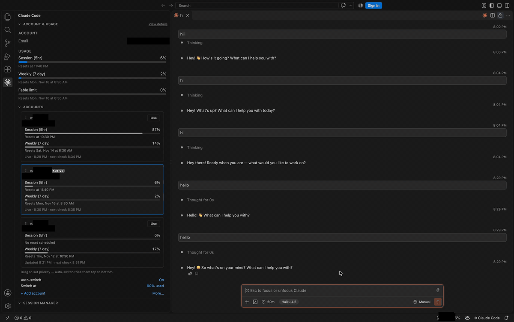

<div align="center">

# Multi Account Switcher for Claude Code

### Switch between multiple Claude accounts inside the Claude Code extension — no repeated sign-ins, no lost chats.

[](https://marketplace.visualstudio.com/items?itemName=uditgoyaludit.claude-code-account-switcher-auto-switch-on-limit)
[](https://marketplace.visualstudio.com/items?itemName=uditgoyaludit.claude-code-account-switcher-auto-switch-on-limit)
[](LICENSE)

**Multiple Claude accounts · one-click account switching · usage limit auto-switch · survives Claude Code updates**

</div>

---

A free, open-source extension for [Visual Studio Code](https://code.visualstudio.com/) that adds **multi-account support to Claude Code**. Add your work and personal Claude accounts, see each account's usage, and switch between them in one click — your chats, settings and history stay exactly where they are.

> **Unofficial.** This project is not made, endorsed or supported by Anthropic. "Claude" and "Claude Code" are trademarks of Anthropic. Make sure using several accounts is allowed by the terms that apply to those accounts.

## Demo



*Account names and emails are blacked out in the recording.*

## Features

- 🔁 **One-click account switching** — swap the active Claude login in place. Open chats, settings and history are untouched; a chat that is mid-reply moves over when the reply finishes.
- ➕ **Add multiple accounts** — sign each account in through the browser; logins are stored per account so switching back never needs a re-sign-in.
- 📊 **Live usage** — see every account's session and weekly usage at a glance, in the panel and the status bar.
- ⚡ **Automatic switching** — optionally move to another account when the active one hits a usage threshold you choose.
- 🛠️ **Survives Claude Code updates** — re-applies itself after every update, so there's no manual step.
- 🔒 **Local and private** — logins stay on your machine, no telemetry, no third-party servers.

## Installation

**From the VS Code Marketplace**

1. Open the Extensions view (`Cmd/Ctrl` + `Shift` + `X`).
2. Search for **Multi Account Switcher for Claude Code**.
3. Click **Install**, then reload the window.

**From a `.vsix` file**

```sh
code --install-extension claude-code-account-switcher-auto-switch-on-limit-1.0.0.vsix
```

## Requirements

- The [Claude Code](https://marketplace.visualstudio.com/items?itemName=anthropic.claude-code) extension (`anthropic.claude-code`) installed in the same editor.
- VS Code 1.84 or later.

## Usage

1. Install the extension and reload the window (`Developer: Reload Window`).
2. Click the account item in the status bar, or open the **Accounts** section in the Claude Code panel.
3. Choose **Add account…**, give it a short name such as `work`, and finish the browser sign-in.
4. Pick an account in the list to switch to it.

If the switcher disappears after a Claude Code update, run **Claude Multi: Re-apply account patch** from the Command Palette and reload the window.

## How it works, and what it changes on your machine

Please read this before installing.

- **It modifies the installed Claude Code extension.** It adds small hooks to Claude Code's `extension.js` and `webview/index.js` and copies `claude-multi.js` into that extension's folder. The original `extension.js` is kept beside it as `extension.js.claude-multi-orig`.
- **It stores your logins locally.** Each account's Claude login is kept in its own slot under `~/.claude-multi/profiles/<name>` (on macOS, in the login keychain). Settings and cached usage live in `~/.claude-multi/`.
- **Network use.** It asks Anthropic's usage endpoint (`api.anthropic.com`) for each account's usage, using that account's own login. Nothing is sent anywhere else, and there is no telemetry.
- **It can break.** The hooks depend on Claude Code's internal structure. If a Claude Code update changes that structure, the extension shows a warning and account switching is off until this extension is updated. Claude Code itself keeps working.

## Removing it

1. Uninstall this extension.
2. Reinstall or update the Claude Code extension to get an unmodified copy (the hooks stay in the current copy until then).
3. Optionally delete `~/.claude-multi/` to remove the stored logins. Claude Code stays signed in with the account that was active.

## FAQ

**Is this official?** No. It's an independent, unofficial community project.

**Will I lose my chats when I switch?** No. Claude Code keeps one folder for chats and settings; switching only swaps which account is logged in, so everything stays in place.

**Does it send my data anywhere?** No. Logins stay on your machine and the only network call is to Anthropic's own usage endpoint, with your own login.

**Which editors work?** VS Code, and VS Code–based editors (Cursor, Windsurf, VSCodium) that run the Claude Code extension.

## Contributing

Issues and pull requests are welcome. This is a small codebase — `extension.js` is the loader and `claude-multi.js` is the switcher and patcher.

## License

[MIT](LICENSE) © Udit Goyal
